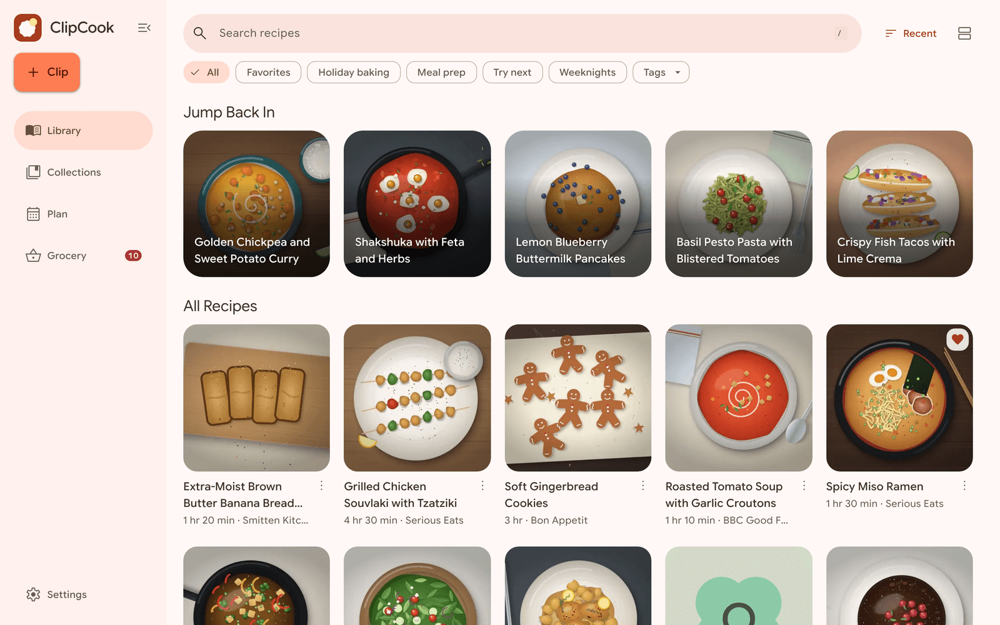
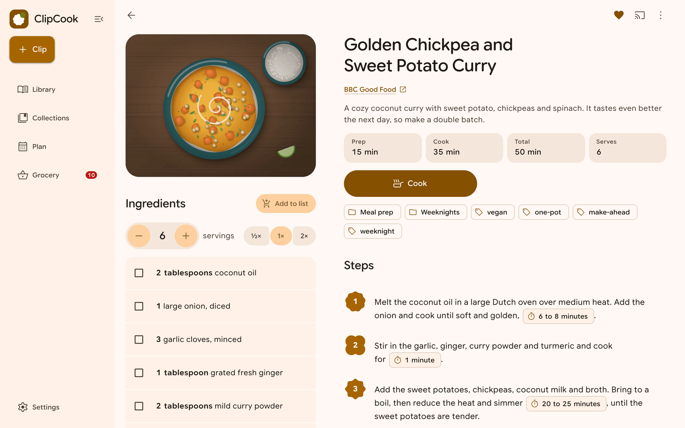
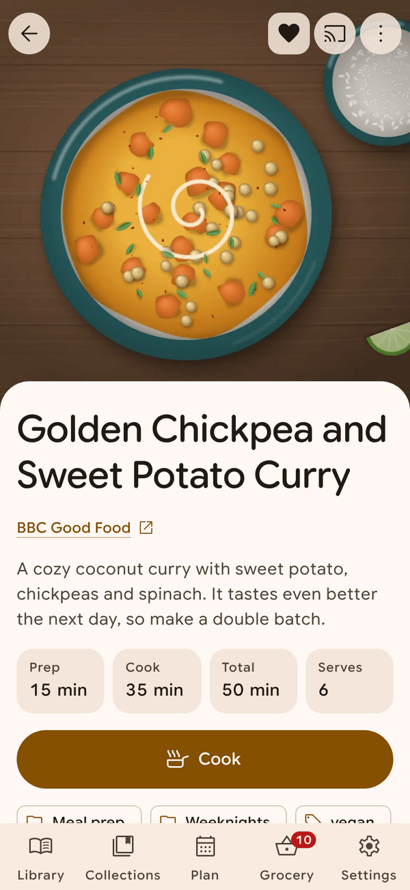
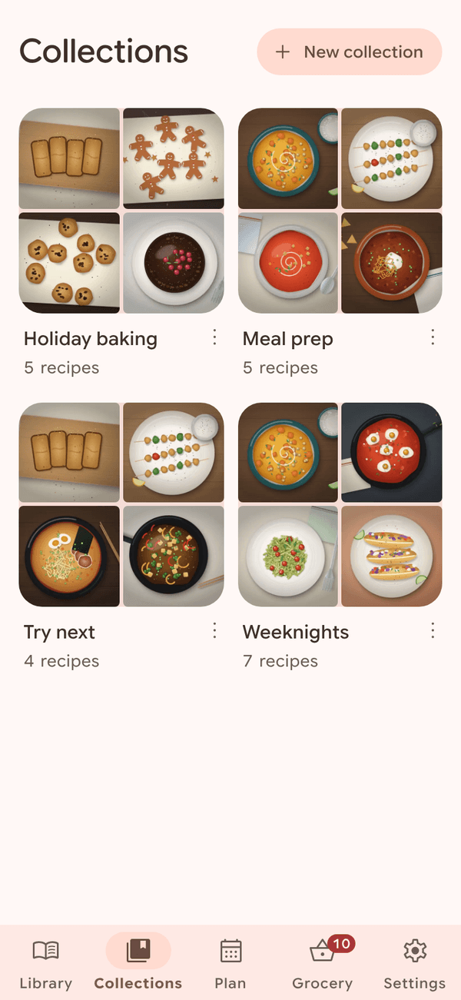
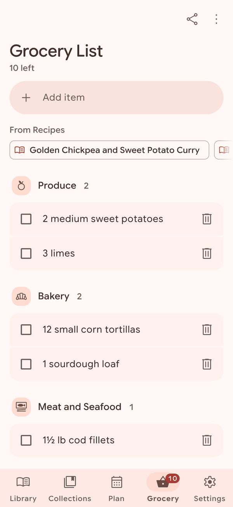

<p align="center">
  
</p>

<h1 align="center">ClipCook</h1>

<p align="center">Save recipes from anywhere, cook from any screen.</p>

<p align="center">
  <a href="https://vercel.com/new/clone?repository-url=https%3A%2F%2Fgithub.com%2Fslukedev%2Fclipcook&env=FIREBASE_ADMIN_PROJECT_ID,FIREBASE_ADMIN_CLIENT_EMAIL,FIREBASE_ADMIN_PRIVATE_KEY,NEXT_PUBLIC_FIREBASE_API_KEY,NEXT_PUBLIC_FIREBASE_AUTH_DOMAIN,NEXT_PUBLIC_FIREBASE_PROJECT_ID,NEXT_PUBLIC_FIREBASE_APP_ID&envDescription=Firebase%20service%20account%20and%20web%20app%20config.%20See%20the%20README%20for%20setup.&envLink=https%3A%2F%2Fgithub.com%2Fslukedev%2Fclipcook%23deploying-with-firebase&project-name=clipcook&repository-name=clipcook"></a>
</p>

ClipCook is an open-source recipe keeper built on Material 3 Expressive. Paste a link, share from your phone, or use the bookmarklet, and ClipCook pulls out the ingredients, steps, photo and times without the life story. Then cook from a full-screen step view, build a grocery list, and send the recipe to your kitchen display in one tap.

<p align="center">
  
</p>

<p align="center">
  
</p>

<p align="center">
  
  
  
</p>

## Features

- **Clip from anywhere.** Paste a link, share from Android or desktop Chrome (ClipCook installs as an app), use the bookmarklet on sites that block servers, or paste the recipe as text. The clipper reads schema.org JSON-LD, microdata and the common WordPress recipe plugins, and falls back to heading detection.
- **Cook mode.** Starts with what to gather and when you'll be done, then shows one step at a time in large type. Swipe or tap to move, timers start from the step text, the current step's ingredients are highlighted, and the screen stays awake. Hands-free voice control is optional.
- **Kitchen displays.** Open ClipCook once on an Echo Show, a tablet or any browser and pair it with a short code. After that, send a recipe from your phone in one tap, and the display follows along as you cook. Google Cast to a Nest Hub works when a Cast app id is configured.
- **Meal plan.** Plan the week by day and meal, see tonight's dish first, move meals by menu or drag and drop, and add the whole week to the grocery list at the servings you planned.
- **Grocery list.** Add ingredients from any recipe at the scale you're cooking. Items merge, group by aisle in store order, and check off offline.
- **Library.** Instant search, favorites, collections, tags, and sorting by recent, most cooked or quickest. New accounts start with a few starter recipes.
- **Scaling.** Change the servings and every quantity follows, with proper fractions.
- **Dynamic color.** Each recipe page takes its colors from the photo.
- **Your data.** Export everything as JSON and import it back.
- **Accessible everywhere.** Light, dark, contrast and motion settings, keyboard support throughout, and layouts for phones, tablets, desktops and smart displays.

## Quick start

You need Node 24.

```bash
npm install
npm run seed:demo
npm run dev
```

Open http://localhost:3000. Without Firebase configured, ClipCook runs on a local file backend (`.data/`) and signs you in as a demo cook. `npm run seed:demo` adds 18 sample recipes.

## Deploying with Firebase

ClipCook stores data in Firestore and signs people in with Google through Firebase Auth. Photos go to Firebase Storage when the project has a bucket, and are stored inline otherwise.

1. Create a Firebase project. Enable **Authentication > Google**, and **Firestore** in production mode. Storage is optional.
2. Copy `.env.example` to `.env.local`, or use your host's environment settings, and fill in the `FIREBASE_ADMIN_*` service account values and the `NEXT_PUBLIC_FIREBASE_*` web app config. Set `APP_URL` to your public origin.
3. Deploy the security rules and indexes:

   ```bash
   firebase deploy --only firestore:rules,firestore:indexes,storage
   ```

   Skip `storage` if the project has no bucket. All data access goes through the server, so the rules deny every client.

4. Optional, on the Blaze plan: in the Firestore console, add TTL policies on the `expiresAt` field for the `clipDrafts`, `displayPairings` and `castTokens` collections so expired records are deleted. Without them they stay, and the app ignores them once expired.
5. Add your domain under **Authentication > Settings > Authorized domains**.
6. Build and run:

   ```bash
   npm run build
   npm start
   ```

### Vercel

The Deploy button at the top clones the repository and asks for the Firebase variables. You can also import the repository yourself and set the same variables. Either way, set `APP_URL` once you know the deployment URL, and do steps 3 to 5 above for the Firebase project.

### Updates

A deployment made from your own copy of the repository can update itself from this one. One account manages it under Settings > Updates, and auto update is on by default.

1. Set `CLIPCOOK_OWNER` to your Firebase user ID or your Google email, so the right account manages updates. Without it, the first account created on the deployment does.
2. Create a [fine-grained GitHub token](https://github.com/settings/personal-access-tokens/new) for your copy with **Contents: Read and write**. Settings > Updates has a link that fills in the form.
3. Add it to your host as `CLIPCOOK_UPDATE_TOKEN` and redeploy.
4. Optional: add `CRON_SECRET` (any random string) so only Vercel's scheduler can start the daily run. Without it the schedule endpoint runs at most once every six hours and answers nothing about your setup.

An update is one commit pushed to your copy's default branch, and your host builds it like any other push. Only files that changed upstream are touched, so your own changes to other files stay. If an update would replace or remove a file you changed, auto update leaves it alone and Settings asks you first. `.github/` is never touched, and update commits say `[skip actions]` so GitHub Actions doesn't run on them.

`CLIPCOOK_OWNER` takes a Firebase user ID or an email address. An email only counts once Google has verified it, and a disabled account never counts. If the value matches no such account, nobody can manage updates until it is fixed. Remove the variable to hand updates back to the first account.

On Vercel the repository comes from the deployment itself. Elsewhere, also set `CLIPCOOK_UPDATE_REPO` to `owner/name`. Auto update runs from Vercel Cron (`vercel.json`); on another host, call `GET /api/cron/update` once a day with `Authorization: Bearer <CRON_SECRET>`.

### Moving from an older ClipCook

If the new deployment uses the same Firebase project as the old app, there is nothing to move: recipes are read in place.

For a new project, export from the old one and import in the app:

1. Put the old project's service account in `.env.legacy` as `LEGACY_FIREBASE_ADMIN_PROJECT_ID`, `LEGACY_FIREBASE_ADMIN_CLIENT_EMAIL` and `LEGACY_FIREBASE_ADMIN_PRIVATE_KEY`.
2. Run the export. Add `--email` if more than one account saved recipes.

   ```bash
   node --env-file=.env.legacy scripts/export-legacy.mjs --email you@example.com
   ```

3. In the new app, open Settings > Import and choose each file in `exports/`. Photos are copied into the new project.

### Google Cast (optional)

Nest Hubs have no browser, so they need Cast. Register a custom receiver in the [Google Cast SDK Developer Console](https://cast.google.com/publish) with the receiver URL `https://<your domain>/display/cast`, then set `NEXT_PUBLIC_CAST_APP_ID`. Echo Shows and tablets don't need this; they pair through `/display` in their browser.

## Environment variables

| Variable                                         | Purpose                                                                                                                                              |
| ------------------------------------------------ | ---------------------------------------------------------------------------------------------------------------------------------------------------- |
| `CLIPCOOK_BACKEND`                               | `firebase` or `local`. Defaults to Firebase when its admin variables exist, otherwise local in development. Production refuses to start without one. |
| `CLIPCOOK_DATA_DIR`, `LOCAL_AUTH_SECRET`         | Local backend storage folder and session signing key.                                                                                                |
| `FIREBASE_ADMIN_*`                               | Service account for server-side Firestore, Auth and Storage.                                                                                         |
| `NEXT_PUBLIC_FIREBASE_*`                         | Web app config used by the Google sign-in popup.                                                                                                     |
| `SESSION_COOKIE_NAME`, `SESSION_COOKIE_MAX_AGE`  | Session cookie settings.                                                                                                                             |
| `APP_URL`                                        | Public origin for QR codes, the bookmarklet and redirects.                                                                                           |
| `TRUST_PROXY_HOPS`                               | Reverse proxies in front of the app, for per-IP rate limits.                                                                                         |
| `NEXT_PUBLIC_CAST_APP_ID`                        | Optional Google Cast receiver app id.                                                                                                                |
| `CLIPCOOK_UPDATE_TOKEN`                          | GitHub token with Contents read and write on your copy of the repository. Turns on [updates](#updates).                                              |
| `CLIPCOOK_UPDATE_REPO`, `CLIPCOOK_UPDATE_BRANCH` | Your copy as `owner/name`, and the branch to update. Vercel provides the repository; the branch defaults to the repository's default branch.         |
| `CRON_SECRET`                                    | Optional. Required on the daily update request when set.                                                                                             |
| `CLIPCOOK_OWNER`                                 | Optional. The account that manages updates, by Firebase user ID or verified email. Defaults to the first account created.                            |

## Scripts

| Command                                               | Purpose                                                        |
| ----------------------------------------------------- | -------------------------------------------------------------- |
| `npm run dev`                                         | Development server                                             |
| `npm run build` / `npm start`                         | Production build and server (bundles the service worker first) |
| `npm test`                                            | Unit tests (Vitest)                                            |
| `npm run test:e2e`                                    | End-to-end tests (Playwright, local backend)                   |
| `npm run typecheck`, `npm run lint`, `npm run format` | TypeScript and Biome                                           |
| `npm run seed:demo`                                   | Reset the local demo account with sample recipes               |
| `npm run generate:theme`                              | Regenerate color and motion tokens                             |
| `npm run generate:icons`                              | Regenerate inlined Material Symbols                            |

## How it's built

- **Next.js 16 App Router** with React 19 and the React Compiler. Pages are server components; interactive parts are small client components.
- **Material 3 Expressive design system** in `src/components/ui`, built on [Base UI](https://base-ui.com) primitives: Google Sans Flex, the 2025 color spec, the Expressive shape library, and M3 spring motion. See [DESIGN.md](DESIGN.md) and `/dev/gallery` in development.
- **Server actions** in `src/actions` validate input with zod and check ownership on every write.
- **Storage** behind one interface in `src/server/db` with Firestore and local file implementations.
- **Clipper** in `src/server/clip`: an SSRF-safe fetcher that validates every resolved address at connect time, follows redirects manually, and caps size and time.
- **PWA** with a share target, offline page and runtime caching (user data is never cached).

## Contributing

See [CONTRIBUTING.md](CONTRIBUTING.md). Security reports go through [SECURITY.md](SECURITY.md).

## License

[GPL-3.0](LICENSE). Material Symbols and Google Sans Flex are licensed by Google under the Apache License 2.0 and the SIL Open Font License respectively.
