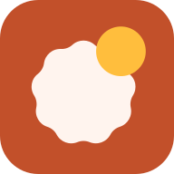

<p align="center">
  
</p>

<h1 align="center">ClipCook</h1>

<p align="center">Save recipes from anywhere, cook from any screen.</p>

ClipCook is an open-source recipe keeper built on Material 3 Expressive. Paste a link, share from your phone, or use the bookmarklet, and ClipCook pulls out the ingredients, steps, photo and times without the life story. Then cook from a full-screen step view, build a grocery list, and put the recipe on the kitchen display in one tap.

## Features

- **Clip from anywhere.** Paste a link, share to ClipCook from Android or desktop Chrome (it installs as an app), use the bookmarklet on sites that block servers, or paste the recipe as text. Reads schema.org JSON-LD, microdata, the common WordPress recipe plugins, and falls back to heading detection.
- **Cook mode.** One step at a time in large type, swipe or tap to move, the screen stays awake, timers start from the step text, ingredients for the current step are highlighted, and optional hands-free voice control.
- **Kitchen displays.** Open ClipCook once on an Echo Show, a tablet, or any browser and pair it with a short code. After that, send a recipe from your phone in one tap, and cook mode keeps the display on the same step. Google Cast to a Nest Hub works when a Cast app id is configured.
- **Grocery list.** Add ingredients from any recipe at the scale you are cooking. Items merge and group by aisle.
- **Library.** Instant search, favorites, collections, tags, and sorting by recent, cooked or quickest.
- **Scaling.** Servings scale every quantity, with proper fractions.
- **Dynamic color.** Every recipe page takes its colors from the photo.
- **Your data.** Export everything as JSON and import it back.
- **Light, dark, contrast and motion settings**, keyboard support throughout, and layouts designed for phones, tablets, desktops and smart displays.

## Quick start

You need Node 24.

```bash
npm install
npm run seed:demo
npm run dev
```

Open http://localhost:3000. Without Firebase configured, ClipCook runs on a local file backend (`.data/`) and signs you in as a demo cook. `npm run seed:demo` adds 18 sample recipes.

## Deploying with Firebase

ClipCook stores data in Firestore and signs people in with Google through Firebase Auth. Photos go to Firebase Storage when the project has a bucket, and are stored inline otherwise.

1. Create a Firebase project. Enable **Authentication > Google**, and **Firestore** in production mode. Storage is optional.
2. Copy `.env.example` to `.env.local` (or your host's environment settings) and fill in the `FIREBASE_ADMIN_*` service account values and the `NEXT_PUBLIC_FIREBASE_*` web app config. Set `APP_URL` to your public origin.
3. Deploy the security rules and indexes:

   ```bash
   firebase deploy --only firestore:rules,firestore:indexes,storage
   ```

   Skip `storage` if the project has no bucket. All data access goes through the server, so the rules deny every client.
4. In the Firestore console, add TTL policies on the `expiresAt` field for the `clipDrafts`, `displayPairings` and `castTokens` collections so expired records are cleaned up.
5. Add your domain under **Authentication > Settings > Authorized domains**.
6. Build and run:

   ```bash
   npm run build
   npm start
   ```

   On Vercel, import the repository and set the same environment variables.

### Google Cast (optional)

Nest Hubs have no browser, so they need Cast. Register a custom receiver in the [Google Cast SDK Developer Console](https://cast.google.com/publish) with the receiver URL `https://<your domain>/display/cast`, then set `NEXT_PUBLIC_CAST_APP_ID`. Echo Shows and tablets don't need this; they pair through `/display` in their browser.

## Environment variables

| Variable                                        | Purpose                                                                                                                                              |
| ----------------------------------------------- | ---------------------------------------------------------------------------------------------------------------------------------------------------- |
| `CLIPCOOK_BACKEND`                              | `firebase` or `local`. Defaults to Firebase when its admin variables exist, otherwise local in development. Production refuses to start without one. |
| `CLIPCOOK_DATA_DIR`, `LOCAL_AUTH_SECRET`        | Local backend storage folder and session signing key.                                                                                                |
| `FIREBASE_ADMIN_*`                              | Service account for server-side Firestore, Auth and Storage.                                                                                         |
| `NEXT_PUBLIC_FIREBASE_*`                        | Web app config used by the Google sign-in popup.                                                                                                     |
| `SESSION_COOKIE_NAME`, `SESSION_COOKIE_MAX_AGE` | Session cookie settings.                                                                                                                             |
| `APP_URL`                                       | Public origin for QR codes, the bookmarklet and redirects.                                                                                           |
| `TRUST_PROXY_HOPS`                              | Reverse proxies in front of the app, for per-IP rate limits.                                                                                         |
| `NEXT_PUBLIC_CAST_APP_ID`                       | Optional Google Cast receiver app id.                                                                                                                |

## Scripts

| Command                                               | Purpose                                                        |
| ----------------------------------------------------- | -------------------------------------------------------------- |
| `npm run dev`                                         | Development server                                             |
| `npm run build` / `npm start`                         | Production build and server (bundles the service worker first) |
| `npm test`                                            | Unit tests (Vitest)                                            |
| `npm run test:e2e`                                    | End-to-end tests (Playwright, local backend)                   |
| `npm run typecheck`, `npm run lint`, `npm run format` | TypeScript and Biome                                           |
| `npm run seed:demo`                                   | Reset the local demo account with sample recipes               |
| `npm run generate:theme`                              | Regenerate color and motion tokens                             |
| `npm run generate:icons`                              | Regenerate inlined Material Symbols                            |

## How it's built

- **Next.js 16 App Router** with React 19 and the React Compiler. Pages are server components; interactive parts are small client components.
- **Material 3 Expressive design system** in `src/components/ui`, built on [Base UI](https://base-ui.com) primitives: Google Sans Flex, the 2025 color spec, the Expressive shape library, and M3 spring motion. See [DESIGN.md](DESIGN.md) and `/dev/gallery` in development.
- **Server actions** in `src/actions` validate input with zod and check ownership on every write.
- **Storage** behind one interface in `src/server/db` with Firestore and local file implementations.
- **Clipper** in `src/server/clip`: an SSRF-safe fetcher that validates every resolved address at connect time, follows redirects manually, and caps size and time.
- **PWA** with a share target, offline page and runtime caching (user data is never cached).

## Contributing

See [CONTRIBUTING.md](CONTRIBUTING.md). Security reports go through [SECURITY.md](SECURITY.md).

## License

[GPL-3.0](LICENSE). Material Symbols and Google Sans Flex are licensed by Google under the Apache License 2.0 and the SIL Open Font License respectively.
